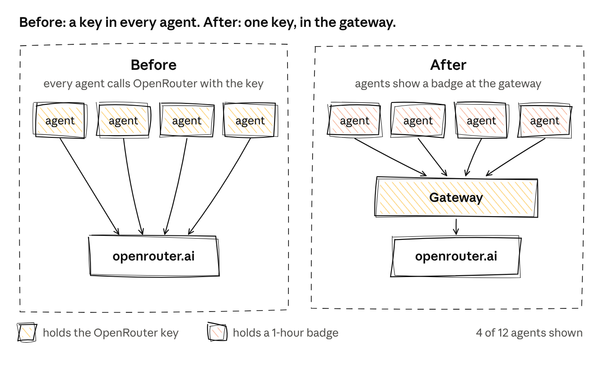
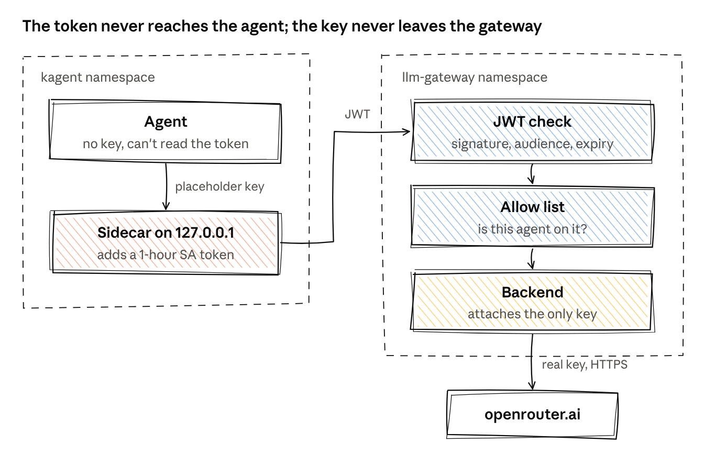
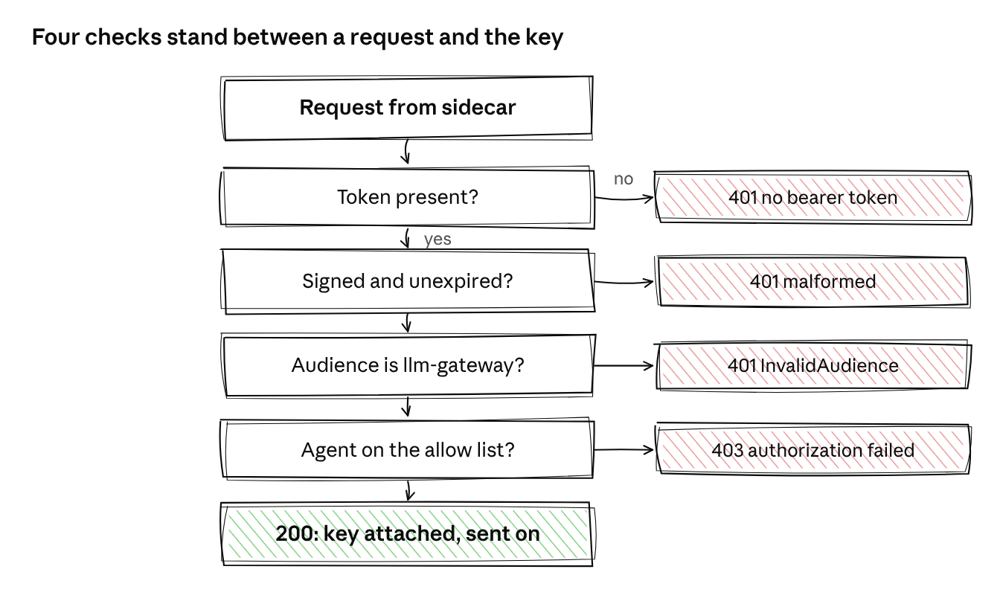

# kagent + agentgateway: LLM access with short-lived workload identity

Example manifests, sidecar source and test scripts from the article series:

- Part 1: [*Your AI Agents Shouldn't Carry the Credit Card*](https://www.linkedin.com/pulse/your-ai-agents-shouldnt-carry-credit-card-john-fox-cgree/). One agent, no API key. The repository as it was for part 1 is tagged [`part-1`](../../tree/part-1).
- Part 2: *Cancelling the Card*. Every agent migrated, the old key revoked, and the controls that keep it that way. This is the current `main`.

**The idea:** [kagent](https://kagent.dev) agents reach OpenRouter without holding any API key. Each agent proves who it is with a short-lived, audience-scoped Kubernetes ServiceAccount token. A dedicated [agentgateway](https://agentgateway.dev) checks the token, the agent's allow list and its budget, then attaches the only copy of the OpenRouter key on the way out.



> **Status: working prototype, not production-hardened.** These manifests are generalised from a homelab where the same controls run for 13 agents on kagent 0.10.4 and agentgateway 1.7.0. The copies here were checked with `kustomize build` and a server-side dry run against that cluster, not deployed from this repository as-is. Read [Known limitations](#known-limitations) before you rely on them.

## How a request flows



1. The agent's `ModelConfig` points at `http://127.0.0.1:8081/v1`: the `llm-token-proxy` sidecar, not OpenRouter.
2. The sidecar reads the projected token file on every request (the kubelet rotates it in place), replaces the `Authorization` header with `Bearer <token>` and forwards to the gateway. If it can't read the token, it returns 502 and forwards nothing.
3. A NetworkPolicy admits only labelled agent pods from the `kagent` namespace to the gateway.
4. The gateway validates the JWT (signature, issuer, `aud=llm-gateway`, expiry) against keys it fetches from the API server.
5. It copies the requested model into a header, then checks the caller's ServiceAccount and that model together against the allow list.
6. It applies the caller's budget (tokens per hour, requests per minute) and the prompt guard.
7. The `AgentgatewayBackend` attaches the OpenRouter key, which exists only in the `llm-gateway` namespace, and calls `openrouter.ai` over TLS. The gateway logs each call with the caller's identity, the model and token usage.

The token volume is mounted only into the sidecar, so the agent container can't read it.

## What part 2 adds

| Control | File | What it does |
|---|---|---|
| One patch for every agent | `manifests/kagent/llm-gateway-sidecar-patch.yaml` | Adds the sidecar, token volume, placeholder key and client label to any Agent labelled `llm-gateway.example.com/enabled: "true"` |
| Model allow list | `manifests/llm-gateway/policy.yaml`, `model-header-policy.yaml` | Each agent may call only its own model. A forged `x-llm-model` header is overwritten from the request body |
| Budgets | `manifests/llm-gateway/policy.yaml` | 300,000 tokens an hour and 60 requests a minute per ServiceAccount; excess gets 429 |
| Prompt guard | `manifests/llm-gateway/prompt-guard-policy.yaml` | Rejects prompts containing credential-shaped strings (403) before they leave the cluster |
| JWKS fetched, not pasted | `policy.yaml`, `kube-apiserver-backend.yaml`, `jwks-discovery-rbac.yaml` | The gateway fetches the cluster's signing keys every 5 minutes, so a rebuild needs no edit |
| Network | `manifests/llm-gateway/networkpolicy.yaml`, `manifests/kagent/networkpolicy.yaml` | Only labelled agent pods reach the gateway; agents have no direct internet access |
| Keep it locked | `manifests/admission/` | ValidatingAdmissionPolicies refuse a shared key coming back, an Agent without the gateway label, and ModelConfigs with an API key |
| Pod Security | `manifests/llm-gateway/namespace.yaml` | The gateway namespace enforces `restricted` |
| `maxTokens` | `manifests/kagent/modelconfig.yaml` | Without it, OpenRouter reserves the model's full output window per request and answers 402 on a low balance |

## Repository layout

```
manifests/
  llm-gateway/                         # the gateway side
    namespace.yaml                     # Pod Security: restricted
    gateway.yaml                       # dedicated ClusterIP Gateway (class agentgateway)
    backend.yaml                       # AgentgatewayBackend (OpenRouter) + HTTPRoute
    policy.yaml                        # JWT (remote JWKS) + per-agent model allow list + budgets
    model-header-policy.yaml           # copies the requested model into x-llm-model
    prompt-guard-policy.yaml           # rejects credential-shaped prompts
    kube-apiserver-backend.yaml        # where the JWKS is fetched from
    jwks-discovery-rbac.yaml           # lets the fetch read the public signing keys
    networkpolicy.yaml                 # gateway ingress and egress
    openrouter-credentials.example.yaml  # Secret shape only - never commit a real key
  kagent/                              # the agent side
    modelconfig.yaml                   # baseUrl -> sidecar, no apiKeySecret, maxTokens
    agent.yaml                         # Agent with the llm-gateway label
    llm-gateway-sidecar-patch.yaml     # sidecar + token volume for every labelled Agent
    networkpolicy.yaml                 # agent egress: DNS, gateway, kagent services
  admission/                           # ValidatingAdmissionPolicies for the kagent namespace
scripts/                               # tests: gateway auth, budget, network, admission
sidecar/                               # llm-token-proxy: ~100 lines of Go, stdlib only
images/                                # diagrams
```

## Prerequisites

- Kubernetes 1.30 or later (ValidatingAdmissionPolicy is GA)
- [kagent](https://kagent.dev) (the homelab runs 0.10.4)
- [agentgateway](https://agentgateway.dev) and its CRDs (the homelab runs 1.7.0), plus the Gateway API CRDs
- A CNI that enforces NetworkPolicy
- An OpenRouter API key, ideally a dedicated one with a credit limit
- A container registry for the sidecar image

## Setup

1. **Build and push the sidecar**, or use the included GitHub Actions workflow:

   ```bash
   docker build -t <your-registry>/llm-token-proxy:latest sidecar/
   docker push <your-registry>/llm-token-proxy:latest
   ```

   Set the image in `manifests/kagent/llm-gateway-sidecar-patch.yaml`, and pin it by digest.

2. **Check the issuer** in `manifests/llm-gateway/policy.yaml` matches your cluster:

   ```bash
   kubectl get --raw /.well-known/openid-configuration
   ```

   There is no key to paste any more: the gateway fetches it.

3. **Create the OpenRouter Secret** in the `llm-gateway` namespace, following `openrouter-credentials.example.yaml`. Encrypt it (for example with SOPS) if it lives in Git. Put a credit limit on the key.

4. **Apply**, or let your GitOps tool do it:

   ```bash
   kubectl apply -k manifests/llm-gateway
   kubectl apply -k manifests/kagent
   kubectl apply -k manifests/admission
   ```

   Apply the admission policies last, once nothing in `kagent` still uses a shared key. Rename `kagent-openrouter` in `manifests/admission/` to the Secret your agents used before.

5. **Add an agent** in one commit: give it the label `llm-gateway.example.com/enabled: "true"`, point it at a `gw-*` ModelConfig, and add `system:serviceaccount:kagent:<agent-name>` to `policy.yaml` next to the model it uses.

## Verify

Each script prints PASS or FAIL per check and exits non-zero on any failure.

```bash
scripts/test-llm-gateway-auth.sh     # identity, model allow list, forged header, prompt guard (8 checks)
scripts/test-network-policies.sh     # gateway ingress, agent egress, agent egress on every node
scripts/test-admission-policies.sh   # 6 manifests that must be refused, 4 that must be accepted
scripts/test-budget.sh               # 65 requests: expect 60 x 403 (guard) then 5 x 429 (budget)
```



Run the network test from scratch after any CNI or node problem. A NetworkPolicy object existing proves nothing, and on the homelab one node's CNI agent once stopped policing new pods while the probes that landed on other nodes still passed.

## Why a sidecar?

kagent's `ModelConfig` can't present the pod's own rotating ServiceAccount token. `apiKeySecret` and `defaultHeaders` are static secrets, `tokenExchange` targets Google Distributed Cloud, and `apiKeyPassthrough` forwards the *caller's* A2A token, not the agent's own identity. If kagent adds native support, drop the sidecar and point `baseUrl` at the gateway.

The sidecar binds to `127.0.0.1` on purpose: binding wider would let other pods borrow the agent's identity. The catch is that the kubelet probes the pod IP, so it has no liveness probe.

## Known limitations

- **One long-lived key still exists**, in one namespace. Give it a credit limit. Budgets count tokens, not money, and a router model such as `openrouter/auto` bills each call at the rate of the model it picks.
- **The token is a bearer token.** Anyone who steals it can use it until it expires (one hour here; 600 seconds is the kubelet minimum). Part 3 binds it to the pod.
- **Tokens can't be revoked early.** They are validated offline, so a deleted pod's token stays valid until it expires. Remove the subject from the allow list to cut an agent off.
- **Plain HTTP inside the cluster** between the sidecar and the gateway.
- **The prompt guard is regex.** Encoded or split secrets, and formats it doesn't list, get through. Masking doesn't apply to streamed responses.
- **The budget numbers are a starting point.** Two homelab agents on `openrouter/auto` exceeded 300,000 tokens an hour.
- **NetworkPolicy is only as good as your CNI.** Agents that clone skills from GitHub at start-up need internet egress, which NetworkPolicy can't narrow to one host.
- **The JWKS endpoint is opened to unauthenticated reads** (public keys and issuer URL only), because the remote fetch can't send a token.
- **The gateway is a single replica** and nothing here alerts on 401, 403 or 429.
- **Only `/v1/chat/completions` is routed.** Add routes for other endpoints as needed.

## Licence

[MIT](LICENSE)
