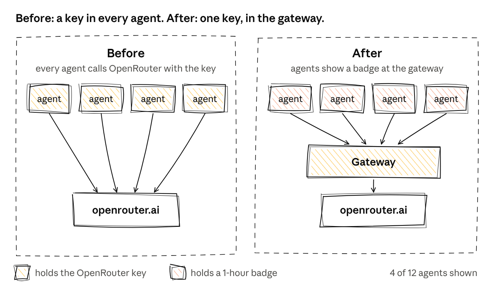
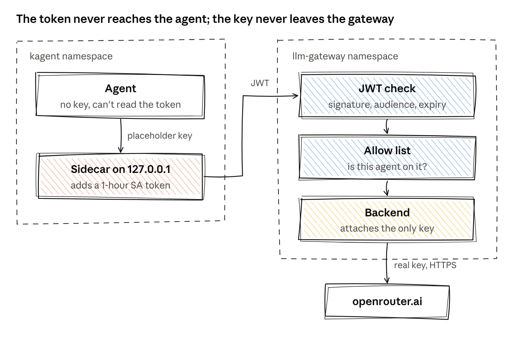
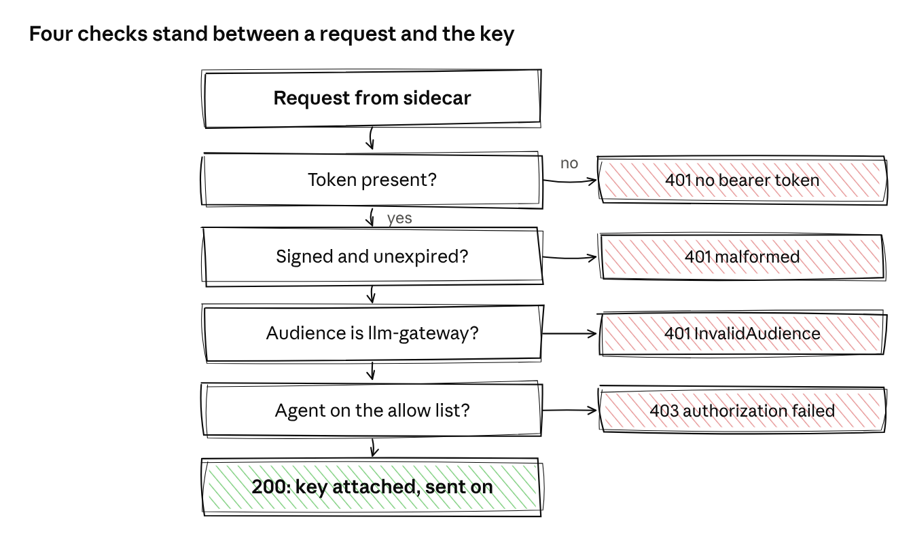

# kagent + agentgateway: LLM access with short-lived workload identity

Example manifests and sidecar source from the article *"Your AI Agents Shouldn't Carry the Credit Card"*.

**The idea:** [kagent](https://kagent.dev) agents reach OpenRouter **without holding any API key**. Each agent proves who it is with a one-hour, audience-scoped Kubernetes ServiceAccount token. A dedicated [agentgateway](https://agentgateway.dev) checks the token and an allow list, then attaches the only copy of the OpenRouter key on the way out.



> **Status: working prototype, not production-hardened.** It was tested end to end with one agent on kagent 0.10.3 and agentgateway 1.6.0. Read [Known limitations](#known-limitations) before you rely on it.

## How a request flows



1. The agent's `ModelConfig` points at `http://127.0.0.1:8081/v1`: the `llm-token-proxy` sidecar, not OpenRouter.
2. The sidecar reads the projected token file **on every request** (the kubelet rotates it in place), replaces the `Authorization` header with `Bearer <token>` and forwards to the gateway. If the token can't be read, it returns 502 and forwards nothing.
3. The gateway's `AgentgatewayPolicy` validates the JWT (signature, issuer, `aud=llm-gateway`, expiry), then checks `jwt.sub` against an allow list.
4. The `AgentgatewayBackend` attaches the OpenRouter key from a Secret that exists only in the `llm-gateway` namespace and calls `openrouter.ai` over TLS.
5. The gateway logs each call with `jwt.sub`, the model and token usage.

The token volume is mounted **only** into the sidecar, so the agent container can't read it.

## Repository layout

```
manifests/
  llm-gateway/                         # the gateway side
    namespace.yaml
    gateway.yaml                       # dedicated ClusterIP Gateway (class agentgateway)
    backend.yaml                       # AgentgatewayBackend (OpenRouter) + HTTPRoute
    policy.yaml                        # JWT authentication + per-agent allow list
    openrouter-credentials.example.yaml  # Secret shape only - never commit a real key
    kustomization.yaml
  kagent/                              # the agent side
    modelconfig.yaml                   # baseUrl -> sidecar, no apiKeySecret
    agent.yaml                         # Agent with projected token volume + sidecar
    kustomization.yaml
sidecar/                               # llm-token-proxy: ~100 lines of Go, stdlib only
images/                                # diagrams
```

## Prerequisites

- A Kubernetes cluster with [kagent](https://kagent.dev) (tested on 0.10.3)
- [agentgateway](https://agentgateway.dev) and its CRDs (tested on 1.6.0), plus the Gateway API CRDs
- An OpenRouter API key, ideally a dedicated one with a credit limit
- A container registry for the sidecar image

## Setup

1. **Build and push the sidecar** (or use the included GitHub Actions workflow):

   ```bash
   docker build -t <your-registry>/llm-token-proxy:latest sidecar/
   docker push <your-registry>/llm-token-proxy:latest
   ```

   Then set the image in `manifests/kagent/agent.yaml`.

2. **Put your cluster's public signing key in the policy.** Paste the output of this command into `jwks.inline` in `manifests/llm-gateway/policy.yaml`:

   ```bash
   kubectl get --raw /openid/v1/jwks
   ```

   Check the `issuer` matches `kubectl get --raw /.well-known/openid-configuration`.

3. **Create the OpenRouter Secret** in the `llm-gateway` namespace, following the shape in `openrouter-credentials.example.yaml`. Encrypt it (for example with SOPS) if it lives in Git.

4. **Apply** (or let your GitOps tool do it):

   ```bash
   kubectl apply -k manifests/llm-gateway
   kubectl apply -k manifests/kagent
   ```

5. **Allow more agents** by adding `system:serviceaccount:<namespace>:<agent-name>` to the `jwt.sub` list in `policy.yaml`, and giving each agent the same volume, sidecar and ModelConfig pattern.

## Verify

```bash
kubectl port-forward -n llm-gateway svc/llm-gateway 18080:80 &
B='{"model":"nvidia/nemotron-3.5-lightning:free","messages":[{"role":"user","content":"hi"}]}'

# No token -> 401
curl -s -o /dev/null -w "%{http_code}\n" localhost:18080/v1/chat/completions \
  -H 'content-type: application/json' -d "$B"

# Allowed agent's token -> 200
T=$(kubectl create token gw-test-agent -n kagent --audience llm-gateway --duration 10m)
curl -s -o /dev/null -w "%{http_code}\n" localhost:18080/v1/chat/completions \
  -H "Authorization: Bearer $T" -H 'content-type: application/json' -d "$B"
```



Results recorded when this was built:

| Request | Response |
|---------|----------|
| No token | 401 `no bearer token found` |
| Garbage token | 401 `malformed` |
| Wrong audience | 401 `InvalidAudience` |
| Valid token, agent not on the allow list | 403 `authorization failed` |
| Allowed agent | 200, `jwt.sub` and token usage logged |

## Why a sidecar?

kagent 0.10.3's `ModelConfig` can't present the pod's own rotating ServiceAccount token. `apiKeySecret` and `defaultHeaders` are static secrets, `tokenExchange` targets Google Distributed Cloud, and `apiKeyPassthrough` forwards the *caller's* A2A token, not the agent's own identity. If kagent adds native support, drop the sidecar and point `baseUrl` at the gateway.

The sidecar binds to `127.0.0.1` on purpose: binding wider would let other pods borrow the agent's identity. The catch is that the kubelet probes the pod IP, so it has no liveness probe.

## Known limitations

- **One long-lived key still exists**, now in one namespace. Give it a spend cap.
- **Nothing forces agents through the gateway.** Add a NetworkPolicy so the gateway is the only egress path, and check your CNI enforces it.
- **No revocation within the token lifetime.** Tokens are validated offline, so a deleted pod's token stays valid until it expires (at most 1 hour). Remove the subject from the allow list to cut an agent off.
- **Confused deputy.** Code running in the agent container can still ask the sidecar to make calls. Add per-agent rate limits and model allow lists.
- **Plain HTTP inside the cluster** between the sidecar and the gateway. Use mTLS or a mesh if prompt confidentiality on the pod network matters.
- **Inline JWKS needs manual refresh** after a cluster rebuild or signing-key rotation.
- **Only `/v1/chat/completions` is routed.** Add routes for other endpoints as needed.
- **Prompts still go to the provider.** This keeps the *key* out of the agent; it does nothing about what's in the prompts.

## Licence

[MIT](LICENSE)
